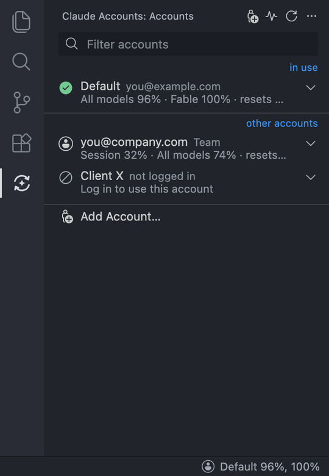
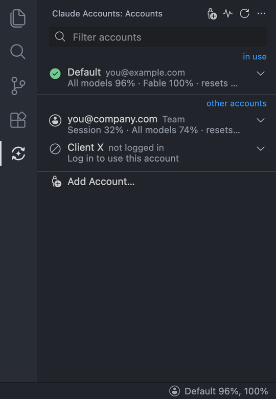
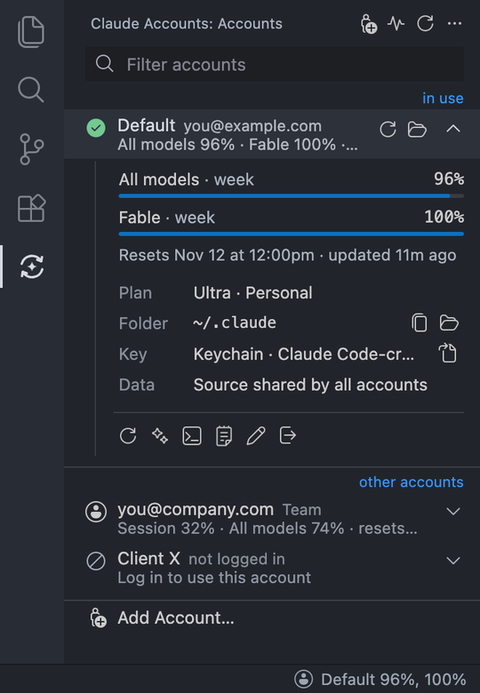

# Claude Account Switch

**Log in once, switch any time.** No more signing in again in the browser every time you change Claude accounts.

Switch between Claude Code accounts from the VS Code sidebar, and keep the same sessions and memory whichever account is active.

> Unofficial community extension. Not affiliated with or endorsed by Anthropic.

## Features

- **Accounts list** showing email and quota for each account. Click one for its usage bars, folder, key and actions.
- **Add accounts** through the official `claude auth login` flow.
- **Switch** to an account, or **Unlink** to go back to the default, in one click. New terminals and Claude Code chats use it; chats already open are reopened on the new account with the same session.
- **Shared sessions and memory.** `--resume`, project memory, `CLAUDE.md`, skills and plugins are the same for every account.
- **Status bar** item showing the active account and its usage, e.g. `Personal 42%, 63%`.
- **Install help** when the Claude Code CLI is missing.

## Screenshots

<table>
  <tr>
    <td align="center"></td>
    <td align="center"></td>
  </tr>
  <tr>
    <td align="center">Accounts list</td>
    <td align="center">Account details</td>
  </tr>
</table>

## Requirements

- VS Code 1.90 or newer, or a compatible fork
- [Claude Code](https://code.claude.com/docs/en/setup) CLI. If it is missing, the extension offers to install it.

## Getting started

1. Open **Claude Accounts** in the activity bar.
2. Click **Add Account…** and finish the login in the terminal that opens. The account is named after its email; rename it any time.
3. Click an account and choose **Switch**. Claude Code chats that are open reopen on that account.

Your existing `~/.claude` login appears as the **Default** account.

## How it works

Each account is its own Claude Code config folder, selected through the documented `CLAUDE_CONFIG_DIR` variable. Only the login is kept per account. Everything else is linked to `~/.claude`, which is why sessions and memory stay shared.

The extension only runs the official `claude` CLI. It never reads, copies or sends your tokens, and it makes no network requests of its own. [Details →](docs/how-it-works.md)

Use it for accounts you own, such as a personal and a work account. Don't use it to share accounts or to get around usage limits.

## Documentation

- [How it works](docs/how-it-works.md): folders, shared data, keys, quota, limitations
- [Configuration](docs/configuration.md): settings, views, shell integration
- [Development](docs/development.md): build, debug and package with Bun

## License

[MIT](LICENSE). Icons: [Codicons](https://github.com/microsoft/vscode-codicons) (CC BY 4.0).
